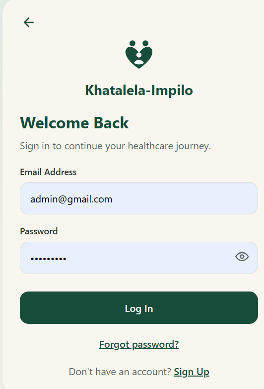
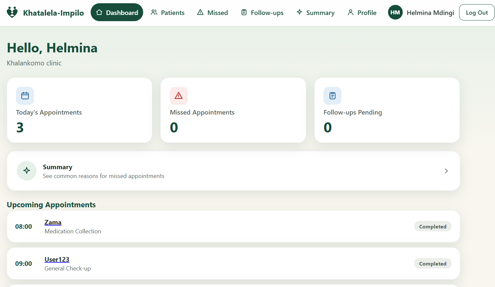

# Khatalela-Impilo (Khathalela Health)

A web app that helps people living with chronic illness keep their clinic visits and medication on track, and helps clinic staff see who needs help. Built for the **FNB App of the Year Hackathon 2026**.

> **All data in the demo is fictional. No real patient information is used.**

- Live app: https://khathalela-health.vercel.app/
- Source code: https://github.com/Siphe23/Khathalela-Health

## The problem

For many people in rural areas, getting chronic care means travel, long waits and missed visits. A missed visit often becomes a missed medication collection. Clinics then find out late. Khatalela-Impilo aims to make the next step clearer for the patient and earlier to see for the clinic. It does not promise shorter queues or automatic medicine delivery.

## Who uses it

| Role | What they can do |
|---|---|
| **Patient** | Book a time slot (up to 2 people per time), save it to a calendar, mark medication as Taken or Missed, record what makes care hard, scan the clinic QR code to check in, send a "Need help now" request |
| **Healthcare worker** | See today's visits, check patients in or mark them missed, see urgent requests, follow up missed visits, read a care summary for each patient, show the clinic QR code |
| **Administrator** | Approve or reject healthcare workers, see users and activity |

Healthcare workers can see patient information only after an administrator marks them as **verified**.

## Features

- Sign up and log in with email and password (Firebase Authentication)
- Time-slot booking, with fully booked times and days shown as full
- Save a booking to Google Calendar, or download an `.ics` file for other calendars
- Medication tracking: Taken or Missed, reported by the patient
- "My Care Progress" page and a concern form
- "Need help now": an urgent request that shows at the top of the nurse's screen, plus emergency numbers **10177** (ambulance) and **112** (any cellphone)
- Clinic QR check-in: the QR holds a web link, so a phone's normal camera can open it. The in-app Scan page also reads it, or reads it from a photo
- Care summary for workers, based on simple rules (not AI)
- Administrator pages for approvals, users and activity
- Web layout with a top menu that becomes a hamburger menu on narrow screens
## 📸 Application Screenshots

### Landing Page


### User Selection Page


### Login Page


### Patient Dashboard


### Admin Dashboard


### Healthcare Worker Dashboard



## Tech stack

- Create React App (JavaScript)
- Redux Toolkit
- React Router
- Firebase Authentication and Cloud Firestore (no Firebase Storage)
- `jsqr` (reads QR codes from the camera) and `qrcode.react` (draws the clinic QR code)
- Plain CSS in `src/css-styles/`
- Hosted on Vercel

## Getting started

### 1. Install

You need [Node.js](https://nodejs.org/) (version 18 or newer).

```bash
git clone https://github.com/Siphe23/Khathalela-Health.git
cd Khathalela-Health
npm install
npm install jsqr qrcode.react
```

### 2. Create a Firebase project

1. Go to the [Firebase Console](https://console.firebase.google.com/) and create a project.
2. **Authentication** → Sign-in method → turn on **Email/Password**.
3. **Firestore Database** → create a database.
4. **Project settings** → Your apps → add a **Web app** and copy its settings.

### 3. Add your settings

Create a file named `.env` in the project root, next to `package.json`:

```
REACT_APP_FIREBASE_API_KEY=
REACT_APP_FIREBASE_AUTH_DOMAIN=
REACT_APP_FIREBASE_PROJECT_ID=
REACT_APP_FIREBASE_STORAGE_BUCKET=
REACT_APP_FIREBASE_MESSAGING_SENDER_ID=
REACT_APP_FIREBASE_APP_ID=

# Optional
REACT_APP_PUBLIC_URL=https://your-app.vercel.app
REACT_APP_DEMO_TOOLS=false
```

- `REACT_APP_PUBLIC_URL` is the website address the clinic QR code points to. Set it to your deployed address so phones can open it. Without it, the QR uses the address the worker page is open on (`localhost` does not work on a phone). No slash at the end.
- `REACT_APP_DEMO_TOOLS=true` shows a "Demo tools" card on the worker dashboard that loads fictional patients and visits. Leave it off for real use.

React reads `.env` only when it starts, so restart `npm start` after changing it. The `.env` file must never be committed to Git.

### 4. Publish the Firestore rules

The rules are the real protection for the data.

1. Firebase Console → Firestore Database → **Rules**.
2. Replace everything with the contents of `firestore.rules` from this project.
3. Click **Publish**.

### 5. Create the administrator invitation code

Administrator sign-up needs a secret code that you create:

1. Firestore Database → **Start collection** → collection ID `settings`.
2. Document ID `adminInvite`.
3. Add a field named `code` (type string) with your secret code.

The code is case sensitive. After your administrator account exists, change the code so it can't be reused.

### 6. Run

```bash
npm start
```

Open http://localhost:3000.

## Trying the app

1. **Register an administrator**: choose Administrator and enter the invitation code.
2. **Register a healthcare worker**. They start as *pending*. Sign in as the administrator and approve them.
3. **Register a patient** in another browser or a private window.
4. As the patient, book a slot, mark medication, and press "Need help now".
5. As the worker, open the dashboard, show the clinic QR code, and watch the patient appear.
6. As the patient, scan the QR code (or use the manual code box) to check in.

The Scan page needs camera access, which browsers allow only on `https://` addresses and `localhost`. If the camera does not work, use "Scan from a photo or screenshot" or type the clinic code.

## Project structure

```
src/
  app/               Redux store
  components/        Shared pieces (AppShell menu, QR code, route guards)
  config/            Roles, booking rules, clinic code
  css-styles/        App.css and other styles
  data/              Fictional demo data
  features/
    auth/            Sign-up, login, auth listener
    care/            Firestore reads and writes, Redux slice, selectors
  firebase/          Firebase setup
  pages/             One file per page
  utils/             Dates, slots, calendar export
firestore.rules      Security rules to publish in Firebase
```

## Deploying to Vercel

1. Push the project to GitHub and import it in [Vercel](https://vercel.com/).
2. Add every variable from your `.env` under Project → Settings → **Environment Variables**, including `REACT_APP_PUBLIC_URL`.
3. Deploy.
4. In Firebase Console → Authentication → Settings → **Authorized domains**, add your Vercel domain.
5. Redeploy after changing any variable, because React reads them at build time.

## Security

- Sign-in uses Firebase Authentication. The app never stores passwords.
- Access control is enforced by Firestore security rules, not just by hiding buttons.
- Healthcare workers must be verified by an administrator before they can read patient data.
- Patients can read only their own records, and can change only the fields they are allowed to.
- Administrator sign-up needs the invitation code.
- The Firebase config values are not secrets. Protection comes from the rules.

## Known limitations

Please be honest about these when presenting:

- The Firestore rules have not been tested on the Firebase emulator.
- Slot capacity is checked in the browser and the rules, but a determined attacker could bypass it. A real product needs a server function for booking.
- The calendar link is a one-time export, not a live sync.
- Medication reminders are a saved setting only. No SMS or push notifications are connected yet.
- The care summary is rule-based. It is not AI.
- Medication records are reported by the patient, not confirmed by the clinic.
- Urgent requests reach a healthcare worker only while they have the dashboard open. They do not replace emergency services.
- Records belong to one account and a preferred-clinic field. There is no transfer-between-clinics or relocation flow yet.
- No legal review against POPIA has been done.

## Roadmap

- Clinic transfer ("I have moved") request, so a new clinic can see a patient's medication list and visit history
- SMS reminders
- A server function for booking and urgent requests
- POPIA review and audit trail of administrator approvals
- Pilot with a clinic and learn from patients and nurses

## Author

Built by Nasiphi Siphesihle Ndzumo for the FNB App of the Year Hackathon 2026.
